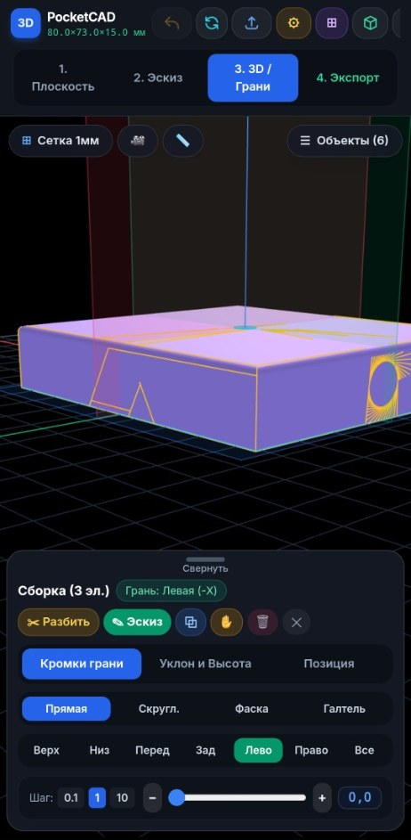
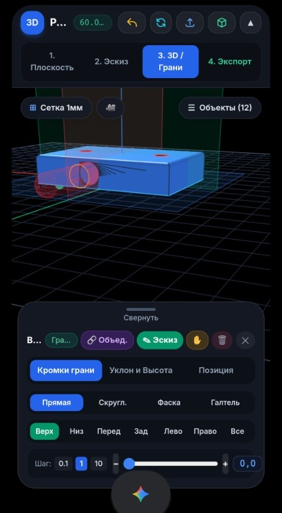

# PocketCAD 3D — Мобильный CAD/STL-редактор под Android

**PocketCAD 3D** — это лёгкий автономный 3D-редактор и генератор деталей для 3D-печати прямо с экрана смартфона. Проект создан в формате **vibe-coding** с прицелом на реальные задачи мейкеров и 3D-печатников: быстро набросать кронштейн, шайбу, корпус датчика или переходник на сетке в миллиметрах и сразу отправить файл в слайсер / на печать.

---

## 📱 Скриншоты интерфейса

  
  &nbsp;&nbsp;&nbsp;
  

---

## 🛠 Технологический стек

* **Ядро и 3D-движок**: Vanilla JavaScript (ES6+) + **Three.js (r128)** + кастомное геометрическое ядро:
  * **3D BSP CSG (Binary Space Partitioning)** — сбалансированное дерево разбиения для честного булева вычитания (`A − B`), глухих карманов, диагональных каналов и взаимного пересечения (`✕ Пересеч.`).
  * **Послойный лофтинг (Watertight Layered Lofting)** — независимое построение фасок, скруглений, уклонов (`Draft`), внешних усиливающих галтелей (`Root Fillet`) и развальцовки отверстий (`Отв.В` / `Отв.Н`) с сохранением замкнутой геометрии (`✓ Manifold`).
  * **Сглаживание и свет**: расчёт нормалей по углу излома (`computeCreasedNormals 42°`), тональная компрессия `ACESFilmicToneMapping` + 3-точечное освещение.
  * **Встроенные экспортеры САПР**: генерация бинарного `.STL`, твердотельного/поверхностного `.STEP (ISO-10303-21 AP214 Faceted B-Rep)` для **КОМПАС-3D** и **Fusion 360**, полигонального `.OBJ` и 2D-чертежей `.DXF`.
* **Интерфейс**: **Tailwind CSS** (адаптивный мобильный UI `100dvh` с поддержкой `safe-area`, свёртываемой нижней шторкой, полноэкранным Zen-режимом по клику на логотип и мультитач-сеткой).
* **Нативная Android-обёртка**: **Kotlin** (`MainActivity.kt`, Android SDK 34, аппаратно-ускоренный `WebView` с полной оффлайн-автономностью, `FileProvider` для прямой передачи `.stl` в слайсер и `MediaStore` для сохранения в `Downloads`).
* **CI/CD**: **GitHub Actions** (`.github/workflows/build-apk.yml`) — автоматическая упаковка локальных ассетов и облачная сборка `APK` при каждом пуше (JDK 17 + Gradle 8.9).

---

## ✨ Возможности

* **Сквозной 4-шаговый пайплайн**: `1. Плоскость` (`XY`, `XZ`, `YZ`, любая грань детали или пользовательская плоскость) → `2. 2D-Эскиз` → `3. 3D / Грани` → `4. Экспорт`.
* **Пользовательские плоскости (Datum Planes)**:
  * **По 2 точкам (`A → B`)**: выбор двух углов/точек прямо на 3D-модели с автопривязкой к вершинам — плоскость строится перпендикулярно оси `A → B` для сквозных диагональных каналов.
  * **Точка + Углы**: задание произвольных координат `X, Y, Z` и углов наклона `RX, RY, RZ`.
* **Инженерный 2D-эскиз и вложенные контуры**:
  * Примитивы повышенной точности: окружность (`64` сегмента), паз (`Slot`, `28` сегментов на дугу), прямоугольник, шестигранник под ключ `S` (`Hex`), полилиния.
  * **Правило чётности (Even-Odd Rule)**: автоматическое вырезание внутренних контуров и сохранение островов при выдавливании многоконтурного эскиза.
  * Пресеты крепежа **M3, M4, M5, M6, M8**, проекция теней 3D-тел, магнитная привязка (`🧲`), мультитач `Pinch-to-Zoom`.
* **3D-моделирование и подготовка к печати**:
  * Независимое сохранение фасок/скруглений/галтелей отдельно для каждой грани (`Верх`, `Низ`, боковые грани) и развальцовка отверстий (`Отв.В`, `Отв.Н`).
  * Линейные (`N × M`) и круговые (`360°`) массивы, генератор метрической резьбы (`ISO M4–M12`), защёлок (`Snap-Fit`) и стоек под печатные платы (`PCB Standoffs`).
  * Палитра цвета пластика для деталей и сборок, 3D-штангенциркуль (`📏 Замер`), автоконтроль замкнутости сетки (`✓ Manifold`), компенсация усадки (`PLA`, `PETG`, `ABS`) и автосохранение проекта.

---

## 🤝 Лицензия, форки и авторство

Это открытый vibe-coded проект. Вы можете свободно изучать код, делать **Fork**, модифицировать его под свои задачи и собирать собственные версии, **при обязательном соблюдении одного условия**:

> **Обязательная атрибуция (Attribution Required)**: при любом форке, публикации, распространении или использовании частей кода необходимо явно указывать автора первоначального образца и ссылку на оригинальный репозиторий:
> * **Автор оригинала**: Андрей Лукьянов ([@Noob7261-rgb](https://github.com/Noob7261-rgb))
> * **Оригинальный репозиторий**: [https://github.com/Noob7261-rgb/PocketCAD](https://github.com/Noob7261-rgb/PocketCAD)

---

## 📦 Быстрая сборка APK через GitHub Actions

1. Запушьте код в ветку `main`.
2. Перейдите во вкладку **Actions** → workflow **Build Android APK**.
3. Скачайте готовый установочный файл из секции **Artifacts** (`PocketCAD-3D-debug-apk`).
